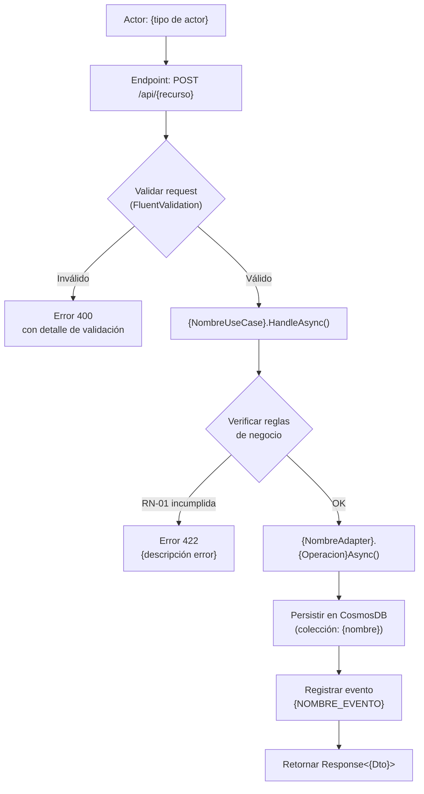
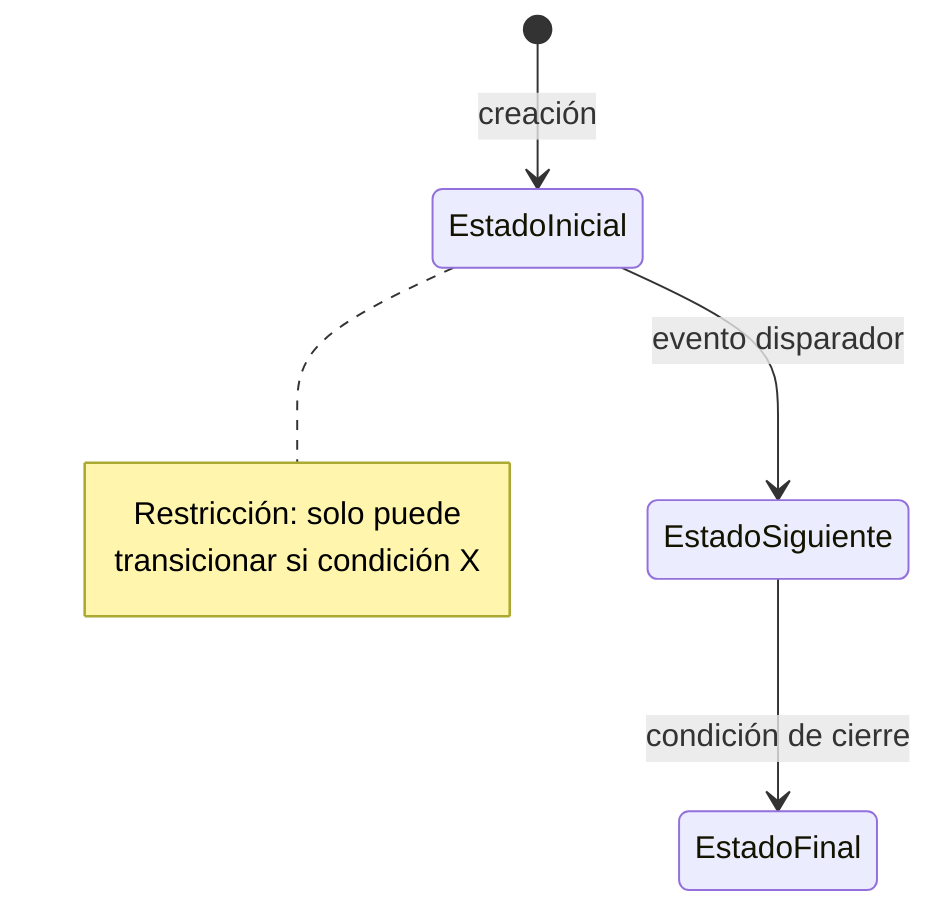
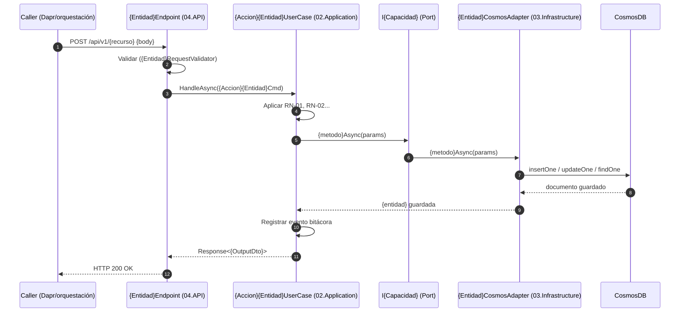

---
name: generador-blueprint-hu
description: "Genera un archivo Blueprint completo (HU_XXXXX_Blueprint.md) a partir de una historia de usuario de ADO previamente sincronizada en este repo. Lee la HU desde el repo de conocimiento local (fuente primaria) y opcionalmente desde ADO (fallback). Incluye análisis técnico, diagramas Mermaid, diseño de implementación por capas, guardrails de programación y una versión portable autocontenida lista para adjuntar al agente en el repo del API destino. USE WHEN: generar blueprint, crear blueprint de historia, preparar contexto para el agente, documentar historia para implementar, HU blueprint, blueprint historia, blueprint para codigo."
argument-hint: "Indica el número de historia, por ejemplo: 'genera el blueprint de la historia 261767' o 'blueprint HU 261533'"
user-invocable: true
---

# Generador de Blueprint de Historia de Usuario

---

## Framework Integration

Este Skill pertenece al Project Profile Marchamo del AI Engineering Framework.

Antes de ejecutar cualquier acción debe seguir obligatoriamente:

- `framework/PRINCIPLES.md` — Principios globales que gobiernan todo el ecosistema.
- `framework/WORKFLOW.md` — Flujo de trabajo oficial: comprender, analizar, planificar, implementar, validar, esperar aprobación.
- `framework/DECISION-TREE.md` — Árbol de decisión para selección de Skills.
- `framework/GIT-POLICY.md` — Política oficial para todas las operaciones Git.
- `framework/CONVENTIONS.md` — Convenciones de nombres, estructura y organización.

---

## Framework Role

**Responsabilidad de este Skill:**
Generar un archivo Blueprint completo (HU_XXXXX_Blueprint.md) a partir de una historia de usuario, incluyendo análisis técnico, diagramas, diseño por capas y guardrails.

**Problema que resuelve:**
Implementar una historia sin un blueprint bien definido genera inconsistencias, deuda técnica y alineamiento insuficiente con la arquitectura del proyecto.

**Responsabilidades que NO tiene este Skill:**
- No implementa el código de la historia (eso es `senior-dotnet` o `create-module`).
- No refina la historia para el sprint (eso es `refinador-historias-ado`).
- No realiza operaciones Git.

---

## Propósito

Dado el ID de una historia de usuario de Marchamo Digital, este skill:

1. Confirma con el usuario que la HU es de implementación de código.
2. Lee el contenido completo de la historia desde el repo de conocimiento local (fuente primaria) y desde ADO solo como fallback.
3. Enriquece el contexto con información cruzada del proyecto: feature padre, épica, peer stories, glosario, baseline arquitectónico y matriz de dependencias.
4. Genera un análisis técnico completo con entidades, reglas, estados y puntos de integración.
5. Produce diagramas Mermaid de flujo principal, estados y secuencia de llamadas.
6. Diseña la implementación por capas siguiendo la arquitectura hexagonal del proyecto.
7. Embebe los estándares de programación y guardrails para validación de PRs.
8. Marca explícitamente los puntos que requieren ajuste humano post-generación.
9. Genera dos archivos: la versión completa (con referencias al repo de conocimiento) y la versión portable autocontenida (lista para adjuntar al agente en el repo del API).
10. Valida el output y maneja idempotencia (regeneración inteligente).

El archivo generado sirve como **instrucción completa para el agente** al momento de implementar código en el repo del API destino (típicamente `Grupo-INS/MarchamoDigital.Validaciones` u otros APIs DDD del proyecto).

---

## Contexto del repositorio

Este skill vive en el repo de conocimiento del proyecto. Ese repo contiene:

- Copia local sincronizada de ADO (historias, épicas, features, tasks).
- Documentos de diseño, arquitectura y matrices conceptuales.
- Glosario del dominio y baseline arquitectónico.

Los repos de programación (APIs DDD) son separados. Este skill **genera el blueprint en el repo de conocimiento** y produce además una versión portable que se adjunta o copia al repo del API correspondiente.

---

## Cuándo usar este skill

- Cuando el desarrollador dice: _"genera el blueprint de la historia XXXXX"_.
- Antes de empezar a codificar una historia nueva en un repo de API.
- Cuando se necesita preparar el contexto completo para sesiones de generación de código con el agente.
- Cuando se quiere tener diagramas y diseño técnico detallado de una historia antes de implementarla.

---

## Fuentes de información

### Fuente primaria — Repo local sincronizado

| Ruta | Propósito |
|------|-----------|
| `Analisis Épicas/stories/pbi_userstory_detailed_index.yaml` | Índice maestro: localizar sprint y feature padre |
| `Analisis Épicas/stories/<sprint>-md/story_<id>.yaml` | Detalle estructurado de la HU |
| `Analisis Épicas/stories/ai_pbi_userstory_conceptual_matrix.yaml` | Épica, feature, peer stories, dependencias |
| `Analisis Épicas/epics/epic_<id>_<codigo>.yaml` | Contexto de la épica padre |
| `Analisis Épicas/features/feature_<id>.yaml` | Contexto del feature padre |
| `Analisis Épicas/shared/architecture_baseline.yaml` | Guardrails técnicos de arquitectura |
| `Analisis Épicas/shared/glossary.yaml` | Términos del dominio |

### Fuente secundaria — ADO REST API (solo fallback)

Solo se invoca si la HU no está sincronizada localmente o si el usuario solicita verificación contra ADO. Requiere variable de entorno `ADO_PAT` configurada.

| Endpoint | Propósito |
|----------|-----------|
| `workitems/{id}?$expand=all` | Datos completos de la HU |
| `workitems/{parent_feature_id}` | Feature padre |

---

## Procedimiento paso a paso

### PASO 0 — Confirmación del tipo de HU

El usuario debe confirmar explícitamente que la HU es de desarrollo. El skill:

1. Lee la HU localmente.
2. Muestra al usuario un resumen breve:
   - Título
   - Descripción (primeras 2-3 líneas)
   - Cantidad de criterios de aceptación
   - Feature y épica padre
3. Pregunta: _"¿Confirmas que esta HU es de implementación de código? (sí / no / parcial)"_
4. Acciones:
   - **"no"** → detener con mensaje cordial.
   - **"parcial"** → preguntar qué secciones aplican y marcar el resto como `_No aplica para esta historia_`.
   - **"sí"** → continuar al PASO 1.

> **Nota:** No clasificar automáticamente. El usuario tiene contexto que el skill no.

### PASO 1 — Cargar la historia desde el repo local

Implementación de referencia (Python):

```python
"""Carga de la historia de usuario desde el repo de conocimiento local."""

import os
import re
import hashlib
import json
from pathlib import Path

import yaml
from bs4 import BeautifulSoup
from markdownify import markdownify as md


def cargar_historia(id_hu: str, repo_base: Path) -> dict:
    """
    Carga la HU desde el repo local (fuente primaria).
    Si no existe localmente, intenta ADO como fallback.

    Args:
        id_hu: ID numérico de la historia (ej: "261767").
        repo_base: Ruta raíz del repo de conocimiento.

    Returns:
        Diccionario con los datos estructurados de la HU.

    Raises:
        RuntimeError: si la HU no se encuentra localmente y no hay PAT configurado.
    """
    # 1. Localizar sprint mediante el índice maestro
    indice_path = repo_base / "Analisis Épicas/stories/pbi_userstory_detailed_index.yaml"
    if not indice_path.exists():
        raise RuntimeError(
            f"Índice maestro no encontrado: {indice_path}. "
            "Ejecuta primero el skill de sincronización ADO."
        )

    with indice_path.open(encoding="utf-8") as f:
        indice = yaml.safe_load(f)

    entrada = indice.get(id_hu) or indice.get(int(id_hu))
    if not entrada:
        return _fallback_ado(id_hu)

    sprint = entrada.get("sprint")
    story_path = repo_base / f"Analisis Épicas/stories/{sprint}-md/story_{id_hu}.yaml"

    if not story_path.exists():
        return _fallback_ado(id_hu)

    # 2. Leer el YAML estructurado de la HU
    with story_path.open(encoding="utf-8") as f:
        return yaml.safe_load(f)


def _fallback_ado(id_hu: str) -> dict:
    """
    Fallback a ADO REST API. Solo se invoca si la HU no está sincronizada localmente.
    Requiere variable de entorno ADO_PAT configurada.
    """
    import base64
    import urllib.request

    pat = os.environ.get("ADO_PAT")
    if not pat:
        raise RuntimeError(
            f"HU {id_hu} no encontrada localmente y ADO_PAT no configurado. "
            "Opciones: (1) ejecuta el skill de sincronización ADO, "
            "o (2) exporta ADO_PAT en tu entorno."
        )

    # Construir request autenticado
    token = base64.b64encode(f":{pat}".encode()).decode()
    headers = {"Authorization": f"Basic {token}"}
    url = (
        "https://dev.azure.com/grupoins/Seguro%20Obligatorio%20Automotor"
        f"/_apis/wit/workitems/{id_hu}?$expand=all&api-version=7.1"
    )

    req = urllib.request.Request(url, headers=headers)
    with urllib.request.urlopen(req, timeout=15) as resp:
        data = json.loads(resp.read())

    # Normalizar al mismo schema que el YAML local
    return _normalizar_workitem_ado(data)


def _normalizar_workitem_ado(data: dict) -> dict:
    """Convierte el JSON crudo de ADO al schema interno usado por el skill."""
    campos = data.get("fields", {})
    return {
        "id": data.get("id"),
        "titulo": campos.get("System.Title", ""),
        "descripcion": _html_a_markdown(campos.get("System.Description", "")),
        "criterios_aceptacion": _html_a_markdown(
            campos.get("Microsoft.VSTS.Common.AcceptanceCriteria", "")
        ),
        "sprint": campos.get("System.IterationPath", ""),
        "feature_padre_id": campos.get("System.Parent"),
        "estado": campos.get("System.State", ""),
        "tags": campos.get("System.Tags", "").split(";") if campos.get("System.Tags") else [],
    }


def _html_a_markdown(html_text: str) -> str:
    """
    Convierte HTML enriquecido (de ADO) a Markdown preservando listas,
    negritas, tablas y saltos de línea. Mucho más robusto que regex.
    """
    if not html_text or not html_text.strip():
        return ""

    # Pre-limpieza: remover comentarios HTML y atributos inline de estilo
    soup = BeautifulSoup(html_text, "html.parser")

    # Eliminar comentarios y scripts
    for tag in soup.find_all(string=lambda t: isinstance(t, type(soup.Comment))):
        tag.extract()
    for tag in soup(["script", "style"]):
        tag.decompose()

    # Convertir a Markdown
    md_text = md(str(soup), heading_style="ATX", bullets="-")

    # Normalizar saltos de línea excesivos
    md_text = re.sub(r"\n{3,}", "\n\n", md_text).strip()
    return md_text
```

### PASO 2 — Enriquecimiento cruzado del contexto

Cargar información adicional del repo de conocimiento que enriquece el blueprint:

```python
def enriquecer_contexto(historia: dict, repo_base: Path) -> dict:
    """
    Carga contexto cruzado del proyecto para enriquecer el blueprint.

    Returns:
        Diccionario con: feature, epica, peer_stories, glosario_filtrado,
        baseline_relevante, dependencias.
    """
    contexto = {}

    # 1. Feature padre completo
    feature_id = historia.get("feature_padre_id")
    if feature_id:
        feature_path = repo_base / f"Analisis Épicas/features/feature_{feature_id}.yaml"
        if feature_path.exists():
            with feature_path.open(encoding="utf-8") as f:
                contexto["feature"] = yaml.safe_load(f)

    # 2. Matriz conceptual: épica, peers, dependencias
    matriz_path = repo_base / "Analisis Épicas/stories/ai_pbi_userstory_conceptual_matrix.yaml"
    if matriz_path.exists():
        with matriz_path.open(encoding="utf-8") as f:
            matriz = yaml.safe_load(f)
        entrada = matriz.get(str(historia["id"])) or matriz.get(historia["id"])
        if entrada:
            contexto["epica"] = entrada.get("epica")
            contexto["peer_stories"] = entrada.get("peer_stories", [])
            contexto["dependencias"] = entrada.get("dependencias", [])

    # 3. Épica padre detallada
    if contexto.get("epica"):
        epica_id = contexto["epica"].get("id")
        epica_codigo = contexto["epica"].get("codigo", "")
        epica_path = repo_base / f"Analisis Épicas/epics/epic_{epica_id}_{epica_codigo}.yaml"
        if epica_path.exists():
            with epica_path.open(encoding="utf-8") as f:
                contexto["epica_detalle"] = yaml.safe_load(f)

    # 4. Glosario filtrado: solo términos que aparecen en la HU
    glosario_path = repo_base / "Analisis Épicas/shared/glossary.yaml"
    if glosario_path.exists():
        with glosario_path.open(encoding="utf-8") as f:
            glosario = yaml.safe_load(f)
        texto_hu = (
            historia.get("titulo", "") + " "
            + historia.get("descripcion", "") + " "
            + historia.get("criterios_aceptacion", "")
        ).lower()
        contexto["glosario_filtrado"] = {
            termino: definicion
            for termino, definicion in glosario.items()
            if termino.lower() in texto_hu
        }

    # 5. Baseline arquitectónico relevante
    baseline_path = repo_base / "Analisis Épicas/shared/architecture_baseline.yaml"
    if baseline_path.exists():
        with baseline_path.open(encoding="utf-8") as f:
            contexto["baseline"] = yaml.safe_load(f)

    # 6. Peer stories ya implementadas: referencias a blueprints previos
    contexto["peers_implementados"] = _buscar_blueprints_peers(
        contexto.get("peer_stories", []),
        repo_base,
    )

    return contexto


def _buscar_blueprints_peers(peer_stories: list, repo_base: Path) -> list:
    """Busca blueprints ya generados de historias peer para reutilizar patrones."""
    blueprints_dir = repo_base / "docs/40_disenos_y_propuestas"
    if not blueprints_dir.exists():
        return []

    resultados = []
    for peer in peer_stories:
        peer_id = str(peer.get("id", ""))
        for pbi_dir in blueprints_dir.glob(f"PBI-{peer_id}-*"):
            blueprint = pbi_dir / f"HU_{peer_id}_Blueprint.md"
            if blueprint.exists():
                resultados.append({
                    "id": peer_id,
                    "titulo": peer.get("titulo", ""),
                    "ruta_blueprint": str(blueprint.relative_to(repo_base)),
                })
    return resultados
```

### PASO 3 — Análisis técnico

Analizar el contenido de la historia enriquecida para extraer:

**3.1 Entidades de dominio**
- Identificar sustantivos principales: objetos que se crean, modifican, consultan o eliminan.
- Para cada entidad: nombre, responsabilidad, campos clave, colección probable en Cosmos.

**3.2 Reglas de negocio**
- Extraer restricciones explícitas (no permitir, solo si, debe, obligatorio).
- Numerarlas como RN-01, RN-02, etc.

**3.3 Estados y transiciones**
- Si la historia maneja estados (flujo de vida de una entidad): extraer el diagrama de estados.
- Identificar estados válidos, transiciones permitidas y transiciones prohibidas.

**3.4 Puntos de integración**
- Identificar dependencias con otros servicios o componentes: Dapr, Service Bus, otros microservicios.
- Identificar el actor (sistema, usuario, otro servicio) que invoca cada operación.

**3.5 Operaciones principales**
- Listar las operaciones que debe exponer el API (máx. 5-7 operaciones principales).
- Para cada una: nombre, tipo (comando/query), input esperado, output esperado.

### PASO 4 — Generar diagramas Mermaid

Generar los diagramas apropiados según la naturaleza de la historia. Mínimo obligatorio: diagrama de flujo principal. Los demás según aplique.

Ver §3 del template (PASO 8) para los formatos exactos.

### PASO 5 — Diseñar la implementación por capas

Mapear cada artefacto a la capa correspondiente de la arquitectura hexagonal del proyecto:

```
{RepoAPI}/
├── 01.Domain/{Contexto}/{NombreEntidad}.cs
├── 02.Application/{Contexto}/
│   ├── Ports/I{Capacidad}.cs
│   ├── UseCases/{Accion}{Entidad}UserCase.cs
│   └── Commands/{Accion}{Entidad}Cmd.cs
├── 03.Infrastructure/{Contexto}/Adapters/{Entidad}CosmosAdapter.cs
├── 04.API/FastEndPoint/{Contexto}/V1/{Entidad}Endpoint.cs
└── 05.Test/{Contexto}/
    ├── {Accion}{Entidad}UserCaseTests.cs
    └── {Entidad}CosmosAdapterTests.cs
```

> **Nota sobre nombrado:** `UserCase` (no `UseCase`) es convención establecida del proyecto. Mantener tal cual; no es error tipográfico.

Para cada artefacto, especificar:
- Nombre exacto (siguiendo convenciones del proyecto)
- Responsabilidad concreta
- Campos/métodos clave
- Dependencias inyectadas

### PASO 6 — Marcar puntos de ajuste humano

Identificar decisiones que el skill toma con criterio pero que el dev debe revisar:

- Nombres de colecciones Cosmos no especificados en la HU.
- Partition keys inferidas.
- Códigos de error de negocio inventados.
- TTL de documentos no especificado.
- Política de Polly (defaults).
- Mensajes de log genéricos.
- Cualquier asunción que no esté explícita en los CAs.

Estos puntos van a la sección §8 del blueprint final.

### PASO 7 — Generar el archivo Blueprint

Crear el archivo en:

```
docs/40_disenos_y_propuestas/PBI-{id}-{short-name}/HU_{id}_Blueprint.md
```

Si el directorio PBI no existe, crearlo con un `00-readme.md` mínimo.

El archivo debe seguir el **template del PASO 9**.

### PASO 8 — Generar versión portable autocontenida

Generar adicionalmente:

```
docs/40_disenos_y_propuestas/PBI-{id}-{short-name}/HU_{id}_Blueprint.portable.md
```

**Diferencias con la versión completa:**

- Inline-iza el glosario filtrado (no referencia archivos externos).
- Inline-iza fragmentos relevantes del baseline arquitectónico.
- Inline-iza resúmenes de peer stories implementadas (no links).
- Elimina toda referencia a rutas del repo de conocimiento.
- Añade al inicio una sección "Cómo usar este archivo con el agente" con instrucciones paso a paso.

**Sección final obligatoria del portable:**

```markdown
## Cómo usar este archivo con el agente

1. Copia este archivo a tu repo del API destino, por ejemplo:
   `<repo-api>/.agents/blueprints/HU_{id}_Blueprint.portable.md`
2. Abre una sesión del agente en el repo del API.
3. Adjunta este archivo al contexto de la conversación.
4. Pide al agente:
   _"Implementa la historia HU#{id} siguiendo este blueprint. Empieza por la
   capa Domain y avanza en orden: Domain → Port → Cmd → UseCase → Adapter →
   Endpoint → Tests. Para cada artefacto, lista primero qué guardrails aplican."_
5. Revisa la sección §8 "Puntos que Requieren Ajuste Humano" antes de hacer merge.
```

### PASO 9 — Template del archivo `HU_{id}_Blueprint.md`

> **IMPORTANTE:** Este template es la estructura que el agente debe completar para cada historia. Todas las secciones marcadas con `<!-- COMPLETAR -->` deben llenarse con información real extraída de la historia enriquecida. No dejar secciones vacías en el output final. Si no hay información disponible, escribir `_No aplica para esta historia_`.

````markdown
<!--
  Blueprint generado automáticamente por el skill generador-blueprint-hu
  Fecha: {YYYY-MM-DD}
  Historia: {id} — {título}
  Sprint: {sprint}
  Repositorio destino: {repo-api}
  Snapshot hash: sha256:{hash}
  Versión blueprint: v{n}
-->

# Blueprint HU#{id} — {título}

> **Uso de este archivo:**
> Este Blueprint es el contexto completo de implementación para el agente.
> Existe también una versión portable autocontenida (`HU_{id}_Blueprint.portable.md`)
> para adjuntar directamente a sesiones del agente en el repo del API destino.

---

## 1. Contexto de la Historia

### 1.1 Metadata

| Campo | Valor |
|-------|-------|
| ID ADO | {id} |
| Título | {título} |
| Sprint | {sprint} |
| Feature padre | F{x} — {título feature} |
| Épica padre | E{x} — {título épica} |
| Estado actual | {estado ADO} |
| Tipo confirmado | Implementación / Parcial |
| Repo API destino | {repo-api} |

### 1.2 Descripción funcional

{descripción en Markdown, ya convertida desde HTML con markdownify}

### 1.3 Criterios de aceptación

**CA-1 — {título}**
- Dado que: ...
- Cuando: ...
- Entonces: ...

**CA-2 — {título}**
- ...

### 1.4 Contexto del feature padre

{1-2 párrafos resumiendo el objetivo de negocio del feature y cómo esta HU encaja}

### 1.5 Contexto de la épica padre

{1 párrafo del objetivo estratégico de la épica}

### 1.6 Historias peer y dependencias

#### Peer stories en el mismo feature

| Historia | Título | Estado | Blueprint previo |
|----------|--------|--------|------------------|
| US#{id} | {título} | {Done / In Progress / New} | {ruta si existe} |

#### Dependencias

| Historia | Título | Tipo de dependencia |
|----------|--------|---------------------|
| US#{id} | {título} | Bloqueante / Relacionada / Insumo |

### 1.7 Glosario relevante para esta historia

| Término | Definición |
|---------|-----------|
| {término} | {definición del glosario del proyecto} |

---

## 2. Análisis Técnico

### 2.1 Clasificación técnica

| Dimensión | Valor |
|-----------|-------|
| Tipo de operación | Comando / Query / Mixto |
| Patrón principal | CRUD / Workflow / Integration |
| Persistencia | CosmosDB (colección: `{nombre}`) |
| Expone endpoint | Sí / No — Método: {HTTP method} |
| Genera evento de bitácora | Sí — Evento: `{NOMBRE_EVENTO}` |
| Consumido por | Dapr / Otro microservicio / UI |

### 2.2 Entidades de dominio

#### `{NombreEntidad}`

- **Colección Cosmos:** `{nombre-coleccion}`
- **Partition key:** `/{campo}`
- **TTL:** {valor o "permanente"}
- **Campos clave:**

| Campo | Tipo | Descripción | Obligatorio |
|-------|------|-------------|-------------|
| `id` | string | Identificador único (ULID) | Sí |
| `{campo}` | {tipo} | {descripción} | Sí/No |

### 2.3 Reglas de negocio

| ID | Regla | Severidad | Origen |
|----|-------|-----------|--------|
| RN-01 | {descripción} | Bloqueante | CA-1 |
| RN-02 | {descripción} | Advertencia | CA-2 |

### 2.4 Estados y transiciones

_No aplica para esta historia_ — o bien — _Ver diagrama §3.2_

**Transiciones prohibidas:**
- {transición prohibida y razón}

### 2.5 Operaciones del API

| Operación | Tipo | Input | Output | Descripción |
|-----------|------|-------|--------|-------------|
| `{NombreOperacion}` | Comando | `{InputDto}` | `Response<{OutputDto}>` | {descripción} |

---

## 3. Diagramas

### 3.1 Flujo principal



### 3.2 Estados (si aplica)



### 3.3 Secuencia de llamadas



---

## 4. Diseño de Implementación

> **Nota sobre nombrado:** `UserCase` (no `UseCase`) es convención establecida del proyecto. Mantener tal cual.

### 4.1 Artefactos a crear por capa

#### Capa 01.Domain — Entidad

```csharp
// Ruta: 01.Domain/{Contexto}/{NombreEntidad}.cs
// Namespace: INS.Domain.MarchamoDigital.Validaciones.{Contexto}

namespace INS.Domain.MarchamoDigital.Validaciones.{Contexto};

/// <summary>
/// Entidad de dominio {NombreEntidad}.
/// {Descripción breve de la responsabilidad de la entidad}.
/// </summary>
public sealed class {NombreEntidad}
{
    /// <summary>Identificador único.</summary>
    public required string Id { get; init; }

    /// <summary>{Descripción del campo}.</summary>
    public required string {Campo1} { get; init; }

    /// <summary>{Descripción del campo}.</summary>
    public required {Tipo} {Campo2} { get; init; }

    // ... campos según análisis §2.2
}
```

#### Capa 02.Application — Puerto

```csharp
// Ruta: 02.Application/{Contexto}/Ports/I{Capacidad}.cs
// Namespace: INS.Application.MarchamoDigital.Validaciones.{Contexto}.Ports

namespace INS.Application.MarchamoDigital.Validaciones.{Contexto}.Ports;

/// <summary>
/// Puerto que define las capacidades requeridas para {capacidad}.
/// Implementado por adaptadores en 03.Infrastructure.
/// </summary>
public interface I{Capacidad}
{
    /// <summary>{Descripción del método}.</summary>
    Task<{NombreEntidad}> {Metodo1}Async({Param} param, CancellationToken ct = default);

    /// <summary>{Descripción del método}.</summary>
    Task<bool> {Metodo2}Async({Param} param, CancellationToken ct = default);
}
```

#### Capa 02.Application — Comando

```csharp
// Ruta: 02.Application/{Contexto}/Commands/{Accion}{Entidad}Cmd.cs
// Namespace: INS.Application.MarchamoDigital.Validaciones.{Contexto}.Commands

namespace INS.Application.MarchamoDigital.Validaciones.{Contexto}.Commands;

/// <summary>
/// Comando para {acción} {entidad}.
/// </summary>
public sealed record {Accion}{Entidad}Cmd(
    string {Campo1},
    {Tipo} {Campo2}
);
```

#### Capa 02.Application — UseCase

```csharp
// Ruta: 02.Application/{Contexto}/UseCases/{Accion}{Entidad}UserCase.cs
// Namespace: INS.Application.MarchamoDigital.Validaciones.{Contexto}.UseCases

namespace INS.Application.MarchamoDigital.Validaciones.{Contexto}.UseCases;

/// <summary>
/// Caso de uso para {acción} {entidad}.
/// Implementa la lógica de negocio según reglas RN-01..RN-N de §2.3.
/// </summary>
public class {Accion}{Entidad}UserCase(
    ILogger<{Accion}{Entidad}UserCase> logger,
    IValidator<{Accion}{Entidad}Cmd> validator,
    I{Capacidad} {capacidad})
    : UserCaseBase(logger, nameof({Accion}{Entidad}UserCase)),
      ICommandController<{Accion}{Entidad}Cmd, Response<{OutputDto}>>
{
    public async Task<Response<{OutputDto}>> HandleAsync(
        {Accion}{Entidad}Cmd cmd, CancellationToken ct = default)
    {
        // 1. Validar comando con FluentValidation
        // 2. Aplicar reglas de negocio (RN-01, RN-02...)
        // 3. Persistir via puerto
        // 4. Registrar evento de bitácora
        // 5. Retornar response
        throw new NotImplementedException("Implementar siguiendo §2.3 y §4.1");
    }
}
```

#### Capa 03.Infrastructure — Adaptador CosmosDB

```csharp
// Ruta: 03.Infrastructure/{Contexto}/Adapters/{Entidad}CosmosAdapter.cs
// Namespace: INS.Infrastructure.MarchamoDigital.Validaciones.{Contexto}.Adapters

namespace INS.Infrastructure.MarchamoDigital.Validaciones.{Contexto}.Adapters;

/// <summary>
/// Adaptador CosmosDB (vía MongoDB API) para {Entidad}.
/// Implementa el puerto I{Capacidad}.
/// </summary>
public class {Entidad}CosmosAdapter : I{Capacidad}
{
    private readonly IMongoCollection<{EntidadDoc}> _collection;

    // Pipeline Polly: static readonly (OBLIGATORIO, ver guardrail B5)
    private static readonly ResiliencePipeline _pipeline = new ResiliencePipelineBuilder()
        .AddRetry(new RetryStrategyOptions
        {
            MaxRetryAttempts = 3,
            BackoffType = DelayBackoffType.Exponential,
            UseJitter = true,
            ShouldHandle = new PredicateBuilder()
                .Handle<MongoConnectionException>()
                .Handle<MongoExecutionTimeoutException>()
        })
        .Build();

    public {Entidad}CosmosAdapter(string connectionString, string databaseName)
    {
        // Fail-fast: ver guardrail B2
        if (string.IsNullOrWhiteSpace(connectionString))
            throw new ArgumentException("Connection string requerida", nameof(connectionString));
        if (string.IsNullOrWhiteSpace(databaseName))
            throw new ArgumentException("Database name requerido", nameof(databaseName));

        // ... inicializar IMongoClient e IMongoCollection
    }

    // ... implementación de los métodos del puerto
}
```

#### Capa 04.API — Endpoint FastEndpoints

```csharp
// Ruta: 04.API/FastEndPoint/{Contexto}/V1/{Entidad}Endpoint.cs
// Namespace: INS.API.MarchamoDigital.Validaciones.FastEndPoint.{Contexto}.V1

namespace INS.API.MarchamoDigital.Validaciones.FastEndPoint.{Contexto}.V1;

/// <summary>
/// Endpoint FastEndpoints para {acción} {entidad}.
/// Solo consumido vía Dapr (ver guardrail A6).
/// </summary>
public class {Entidad}Endpoint(
    ICommandController<{Accion}{Entidad}Cmd, Response<{OutputDto}>> useCase)
    : Endpoint<{RequestDto}, Response<{OutputDto}>>
{
    public override void Configure()
    {
        Post("/api/v1/{recurso}");
        // Configurar según estándar del proyecto (auth, versioning, etc.)
    }

    public override async Task HandleAsync({RequestDto} req, CancellationToken ct)
    {
        var cmd = new {Accion}{Entidad}Cmd(req.{Campo1}, req.{Campo2});
        var result = await useCase.HandleAsync(cmd, ct);
        await SendAsync(result, cancellation: ct);
    }
}
```

### 4.2 Contrato del endpoint

**Request:**
```json
{
  "{campo1}": "{tipo y descripción}",
  "{campo2}": "{tipo y descripción}"
}
```

**Response (éxito 200):**
```json
{
  "success": true,
  "data": {
    "{campoOutput1}": "{tipo y descripción}"
  }
}
```

**Errores esperados:**

| Código | Escenario |
|--------|-----------|
| 400 | Validación de entrada fallida |
| 422 | Regla de negocio incumplida (ej: {RN-01}) |
| 500 | Error interno inesperado |

### 4.3 Eventos de bitácora

| Evento | Cuándo se registra | Campos obligatorios |
|--------|-------------------|---------------------|
| `{NOMBRE_EVENTO}` | Al completar {operación} | actor, timestamp, CorrelationId, {específicos} |

### 4.4 Estrategia de pruebas

#### Tests unitarios (sin CosmosDB real)

| Test class | Qué prueba |
|------------|------------|
| `{Accion}{Entidad}UserCaseTests` | Lógica del UseCase con mock del puerto |
| `{Entidad}RequestValidatorTests` | Validaciones FluentValidation (positivos y negativos) |

#### Tests de integración (con CosmosDB real)

Usar `[Trait("Category","LiveCosmos")]`.

| Test class | Qué prueba |
|------------|------------|
| `{Entidad}CosmosAdapterTests` | Persistencia real en Cosmos Dev |

---

## 5. Guardrails de Programación

> ⚠️ **Sección crítica para el agente:** estos guardrails son restricciones técnicas del proyecto. Todo código generado DEBE cumplirlos. Cualquier violación bloquea el PR.

### 5.1 Arquitectura (🔴 BLOQUEANTE)

| Regla | Descripción |
|-------|-------------|
| A1 | Puertos (`I*` interfaces) solo en `02.Application/Ports/` |
| A2 | Adaptadores solo en `03.Infrastructure` o `04.API` |
| A3 | `01.Domain` NO puede referenciar Application ni Infrastructure |
| A4 | `INS.Core.Base` solo como paquete NuGet — **nunca** `<ProjectReference>` |
| A5 | Endpoints FastEndpoints en `04.API/FastEndPoint/{Contexto}/V{N}/` |
| A6 | Endpoints consumidos solo vía Dapr — no exponer públicamente |
| A7 | UserCases heredan de `UserCaseBase` e implementan `ICommandController<Cmd, Response<T>>` |

**Convenciones de nombrado obligatorias:**

| Artefacto | Convención | Ejemplo |
|-----------|------------|---------|
| Comando | `{Accion}{Entidad}Cmd` | `AsignarEtiquetaRfidCmd` |
| UseCase | `{Accion}{Entidad}UserCase` | `AsignarEtiquetaRfidUserCase` |
| Validator | `{Entidad}RequestValidator` | `AsignarEtiquetaRfidRequestValidator` |
| Endpoint | `{Entidad}Endpoint` | `EtiquetaRfidEndpoint` |
| Puerto | `I{Capacidad}` | `IInventarioEtiquetas` |
| Repositorio | `I{Entidad}Repository` | `IEtiquetaRfidRepository` |

### 5.2 Código — Calidad (🔴 BLOQUEANTE)

| Regla | Descripción |
|-------|-------------|
| B1 | **No usar `!`** (null-forgiving). Manejar null explícitamente. |
| B2 | **Fail-fast en cadena de conexión:** `string.IsNullOrWhiteSpace()` con `throw`, nunca `?? throw` sobre string vacío. |
| B3 | **Sin secretos en código.** `appsettings.json` solo con placeholder `""`. Secretos via `AddCanonicalKeyVaultSecrets(...)`. |
| B4 | **Sin doble serialización:** si el tipo ya es `JsonObject`, no re-serializar. Usar `if (datos is JsonObject jObj)`. |
| B5 | **Polly `static readonly`:** el `ResiliencePipeline` es `static readonly` (thread-safe). No instanciar por request. |
| B7 | **Entidades de dominio:** `public sealed class`, propiedades `init`-only, sin setters públicos. |
| B9 | **Namespaces:** deben iniciar con `INS.{Capa}.MarchamoDigital.Validaciones` y reflejar carpetas. |

**Lifetimes de DI:**

| Servicio | Lifetime |
|----------|----------|
| UserCases (stateless) | `Transient` o `Scoped` |
| Validators (FluentValidation) | `Scoped` |
| CosmosDB repositories | `Singleton` |
| Polly `ResiliencePipeline` | `static readonly` field |

### 5.3 Tests — Calidad (🔴 BLOQUEANTE)

| Regla | Descripción |
|-------|-------------|
| C1 | **Sin test placeholder:** toda prueba con al menos una aserción real. `Assert.True(true)` es bloqueante. |
| C2 | **Tests unitarios sin Cosmos:** no conectar a Cosmos. Mockear `I{Capacidad}`. |
| C3 | **Tests LiveCosmos:** usar `[Trait("Category","LiveCosmos")]`. |
| C4 | **Tests de adaptadores:** instanciar el **adaptador real**, no mockear la interfaz que implementa. |

**Estructura de test obligatoria:**

```csharp
[Fact]
public async Task {Operacion}_Con{Escenario}_Debe{Resultado}()
{
    // Arrange
    var fake = {Entidad}Fake.Build();
    // ...

    // Act
    var result = await _sut.{Metodo}Async(fake);

    // Assert
    result.Should().NotBeNull();
    result.{Campo}.Should().Be(expected);
}
```

### 5.4 CosmosDB vía MongoDB API (🔴 BLOQUEANTE)

| Regla | Descripción |
|-------|-------------|
| D1 | Repository registrado como `Singleton` en DI |
| D2 | Fail-fast si `string.IsNullOrWhiteSpace(connectionString)` |
| D3 | `static readonly ResiliencePipeline` para reintentos de Mongo |
| D5 | Manejar `MongoConnectionException` + `MongoExecutionTimeoutException` en Polly. **No usar `MongoTimeoutException`** (eliminado en v3.x). |

### 5.5 Seguridad (🔴 BLOQUEANTE)

| Regla | Descripción |
|-------|-------------|
| F1 | Sin secretos en código ni `appsettings.json` |
| F2 | Key Vault: `AddCanonicalKeyVaultSecrets("CONNECTIONSTRINGS--COSMOSDBMONGODB")` en `Program.cs` |
| F3 | Sin credenciales en logs |
| F4 | Todos los endpoints con `IValidator<T>` FluentValidation |

### 5.6 CI/CD — Checks obligatorios

El PR debe pasar todos estos checks antes del merge:

`Semgrep` · `DevSkim` · `Gitleaks` · `TruffleHog` · `Hadolint` · `Dockle` · `NuGet Audit` · `Dependency Review` · `License Check` · `Integration Tests` · `Build` · `PR Validate` · `PR Size Check` (≤ 800 líneas diff)

---

## 6. Checklist DoD Técnico

- [ ] Todos los artefactos de §4.1 creados y compilando
- [ ] Endpoint responde correctamente para flujo feliz
- [ ] Todas las reglas de negocio de §2.3 implementadas
- [ ] Validaciones FluentValidation para todos los campos del request
- [ ] Tests unitarios con cobertura ≥ 80%
- [ ] Tests de integración LiveCosmos con Cosmos Dev
- [ ] Eventos de bitácora registrados (§4.3)
- [ ] Sin secretos en código
- [ ] Polly `static readonly` configurado
- [ ] 17 CI checks pasando en el PR
- [ ] Título del PR siguiendo Conventional Commits
- [ ] Diff del PR ≤ 800 líneas
- [ ] Puntos §8 revisados y resueltos

---

## 7. Instrucciones para el agente

```
ROLE: Senior .NET architect implementing one user story.

CONTEXT: HU#{id} — {título}. Repo destino: {repo-api}.

TECH STACK: .NET 10, C#, FastEndpoints, CosmosDB vía MongoDB Driver v3.4.0,
Polly v8, FluentValidation, xUnit + Moq + FluentAssertions.

ARCHITECTURE: hexagonal, 5 capas (Domain → Application → Infrastructure → API → Test).

TASK: Implementar la HU siguiendo este blueprint como contrato.

ORDER: Generar artefactos en este orden:
  1. 01.Domain — Entidad
  2. 02.Application — Puerto
  3. 02.Application — Comando
  4. 02.Application — UseCase + Validator
  5. 03.Infrastructure — Adapter
  6. 04.API — Endpoint
  7. 05.Test — Tests unitarios e integración

FORMAT: Un archivo por respuesta, con ruta completa como primera línea.

CONSTRAINTS:
  - Seguir EXACTAMENTE las convenciones de nombrado de §5.1.
  - Aplicar TODOS los guardrails de §5.2-§5.5 — son restricciones, no sugerencias.
  - Para cada artefacto, listar primero qué guardrails aplican.

VERIFICATION:
  - Antes de cada archivo, listar guardrails aplicables.
  - Después de cada archivo, marcar checklist §6 que cubre.

AMBIGUITIES:
  - Si encuentras ambigüedad en los CAs de §1.3, detente y pregunta.
  - Si una decisión cae en §8 (ajuste humano), márcala con // TODO HUMANO: ...
```

---

## 8. Puntos que Requieren Ajuste Humano

> Esta sección lista las decisiones que el blueprint/agente toman con criterio pero que el dev debería revisar antes de hacer merge.

| Punto | Por qué requiere ajuste | Ubicación esperada |
|-------|-------------------------|---------------------|
| Nombre de colección Cosmos | Convención inferida — confirmar con DBA | `appsettings.json`, adapter |
| Partition key | Heurística basada en consultas frecuentes esperadas | Adapter |
| Códigos de error de negocio | No están en el CA — placeholders | UseCase |
| Mensajes de log | Genéricos — ajustar a estándar del proyecto | UseCase, Adapter |
| TTL de documentos | No especificado en HU — asumido permanente | Adapter |
| Política Polly (3 retries exponencial) | Default — puede no aplicar al caso | Adapter |
| {Otros puntos detectados durante el análisis} | {Razón} | {Ubicación} |

---

## 9. Trazabilidad

| Sección Blueprint | Fuente |
|-------------------|--------|
| §1.2 Descripción | `System.Description` ADO / `story_{id}.yaml` |
| §1.3 CAs | `Microsoft.VSTS.Common.AcceptanceCriteria` ADO / `story_{id}.yaml` |
| §1.4 Feature | `feature_{id}.yaml` |
| §1.5 Épica | `epic_{id}_{codigo}.yaml` |
| §1.6 Peers | `ai_pbi_userstory_conceptual_matrix.yaml` |
| §1.7 Glosario | `shared/glossary.yaml` (filtrado) |
| §5 Guardrails | `shared/architecture_baseline.yaml` + estándares fijos del skill |
````

### PASO 10 — Validación del output

Antes de escribir el archivo a disco, validar:

```python
def validar_blueprint(contenido: str) -> list[str]:
    """
    Valida el blueprint generado antes de escribirlo a disco.

    Returns:
        Lista de errores. Vacía = blueprint válido.
    """
    errores = []

    # 1. Sin placeholders sin llenar
    if "<!-- COMPLETAR -->" in contenido:
        errores.append("Quedan marcadores <!-- COMPLETAR --> sin llenar")

    # 2. Todas las secciones obligatorias presentes
    secciones_requeridas = [
        "## 1. Contexto de la Historia",
        "## 2. Análisis Técnico",
        "## 3. Diagramas",
        "## 4. Diseño de Implementación",
        "## 5. Guardrails de Programación",
        "## 6. Checklist DoD Técnico",
        "## 7. Instrucciones para el agente",
        "## 8. Puntos que Requieren Ajuste Humano",
        "## 9. Trazabilidad",
    ]
    for seccion in secciones_requeridas:
        if seccion not in contenido:
            errores.append(f"Falta sección obligatoria: {seccion}")

    # 3. Al menos un diagrama Mermaid de flujo
    if not re.search(r"```mermaid\s+flowchart", contenido):
        errores.append("Falta diagrama de flujo principal (§3.1)")

    # 4. Placeholders literales sin reemplazar (fuera de bloques de código)
    # Excluir bloques ``` para no falsear con los templates intencionales
    contenido_sin_codigo = re.sub(r"```.*?```", "", contenido, flags=re.DOTALL)
    placeholders = re.findall(r"\{[A-Z][a-zA-Z]+\}", contenido_sin_codigo)
    if placeholders:
        errores.append(
            f"Placeholders sin resolver fuera de bloques de código: "
            f"{set(placeholders)}"
        )

    # 5. Metadata mínima del encabezado
    if "Snapshot hash:" not in contenido:
        errores.append("Falta snapshot hash en el encabezado")
    if "Versión blueprint:" not in contenido:
        errores.append("Falta versión del blueprint en el encabezado")

    return errores
```

Si `validar_blueprint()` retorna errores, mostrarlos al usuario y NO escribir el archivo. Pedir confirmación o corregir.

### PASO 11 — Idempotencia y versionado

Antes de generar, verificar si ya existe un blueprint previo:

```python
def determinar_accion(blueprint_path: Path, historia_actual: dict) -> tuple[str, str | None]:
    """
    Determina la acción a tomar según el estado actual del blueprint.

    Returns:
        Tupla (accion, hash_anterior) donde acción es:
          - "crear": no existe blueprint previo
          - "sin-cambios": el blueprint existe y la HU no cambió
          - "actualizar": el blueprint existe pero la HU cambió
    """
    if not blueprint_path.exists():
        return ("crear", None)

    contenido = blueprint_path.read_text(encoding="utf-8")
    match = re.search(r"Snapshot hash:\s*sha256:(\w+)", contenido)
    hash_anterior = match.group(1) if match else None

    # Calcular hash del estado actual de la HU
    hash_actual = hashlib.sha256(
        json.dumps(historia_actual, sort_keys=True, ensure_ascii=False).encode()
    ).hexdigest()

    if hash_anterior == hash_actual:
        return ("sin-cambios", hash_anterior)
    return ("actualizar", hash_anterior)
```

**Comportamiento según acción:**

| Acción | Comportamiento |
|--------|----------------|
| `crear` | Generar blueprint v1 normalmente |
| `sin-cambios` | Notificar al usuario: _"Blueprint ya está sincronizado con la HU. No se realizó ningún cambio."_ |
| `actualizar` | Detectar diferencias clave y preguntar al usuario: _"La HU cambió desde la última generación. Cambios detectados: [listar]. ¿Regenerar como v{n+1}? (sí / no / diff)"_ |

Al regenerar:
- Incrementar el número de versión en el encabezado.
- Conservar el blueprint anterior renombrándolo a `HU_{id}_Blueprint.v{n-1}.md`.
- O bien usar git como historial (recomendado si el repo tiene commits frecuentes).

---

## Estructura final de archivos generados

```
docs/40_disenos_y_propuestas/
└── PBI-{id}-{short-name}/
    ├── 00-readme.md                        ← Resumen del PBI
    ├── HU_{id}_Blueprint.md                ← Blueprint completo (referencia interna)
    └── HU_{id}_Blueprint.portable.md       ← Versión portable para el agente
```

Si el directorio `PBI-{id}-{short-name}/` no existe, crearlo con un `00-readme.md` mínimo:

```markdown
# PBI-{id} — {título}

Estado: Blueprint generado — pendiente implementación.

- Blueprint completo: `HU_{id}_Blueprint.md`
- Blueprint portable (para el agente): `HU_{id}_Blueprint.portable.md`
```

---

## Notas operativas

- **Idioma:** el Blueprint se genera en español (es-CR) por defecto.
- **Idempotencia:** regenerar la misma HU es seguro; el skill detecta cambios y pregunta antes de sobreescribir.
- **PAT opcional:** `ADO_PAT` solo se usa como fallback. La fuente primaria es siempre el repo local.
- **Convención `UserCase`:** mantener tal cual (no es typo, es estándar del proyecto).
- **Nomenclatura de archivo:** siempre `HU_{id}_Blueprint.md` — sin guiones en el nombre, `HU` en mayúsculas.
- **Portable vs completo:** la versión completa referencia el repo de conocimiento; la portable es autocontenida para uso con el agente.
- **Validación obligatoria:** si `validar_blueprint()` falla, el archivo NO se escribe.
- **Trazabilidad:** la sección §9 del blueprint mapea cada parte a su fuente, facilitando auditoría.

---

## Dependencias del skill

Paquetes Python requeridos:

```bash
pip install pyyaml beautifulsoup4 markdownify
```

Variables de entorno:

| Variable | Obligatoria | Propósito |
|----------|-------------|-----------|
| `ADO_PAT` | No (solo fallback) | Personal Access Token de ADO para descarga directa de HUs no sincronizadas |

---

## Skill Collaboration

Cuando la solicitud requiera capacidades fuera del dominio de este Skill, coordinar con el Skill correspondiente siguiendo `framework/DECISION-TREE.md`.

| Necesidad | Skill |
|---|---|
| Analizar los requisitos de la historia | `analizador-de-requisitos` |
| Refinar la historia antes del blueprint | `refinador-historias-ado` |
| Implementar el código del blueprint | `senior-dotnet` / `create-module` |
| Revisar el PR resultante | `pr-review-marchamo` |

---

## Completion Checklist

Antes de considerar terminada cualquier tarea:

- □ Se respetó el Framework (Principles, Workflow, GIT-Policy, Conventions).
- □ Se siguió el Workflow.
- □ Se utilizó el Skill correcto.
- □ Se mantuvieron cambios mínimos.
- □ Se mantuvo consistencia con el proyecto.
- □ Se espera aprobación del desarrollador antes de cualquier operación Git.